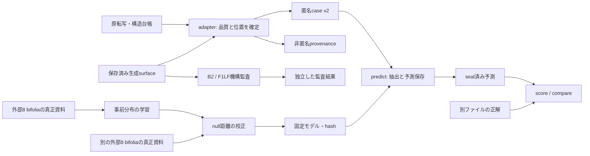

# 審判団 v0.3 実装設計

実装版: `judges-v0.3-v1`。学習済みモデルと実験成績はコードから分離した成果物として保存する。

機械可読契約は`contracts/`、実行手順は[README](README.md)。分割はcorpusの外側foldから固定規則で導出し、各modelへ保存する。旧方式の仕様は`judges/SPEC.md`。

## 1. 設計上の決定

| 決定 | 仕様 |
|---|---|
| 評価目標 | 識別力のある審判でも真正と疑似を識別できない状態。上下両方向の50%からの隔たり、coverage、不確実性を確認する |
| 旧版 | v0.2の入力・設定・予測・成績を保存する。再解釈と新しい採点を別記録にする |
| 植物境界 | PLANTでsegmentを切る。物理LINE_ENDと区別する。図後を行頭へ昇格させない |
| 観測 | 可視surfaceを同じstable22規則で処理する。mを残す。内部anchorを真正・疑似の対決に混ぜない |
| 部分可読 | 語列全体、末尾だけ、観測不能を異なる型で表す。末尾だけのデータから1語行を作らない |
| 集計単位 | bifolium。反復seed・4面の持ち回り・対照の反復は同じcluster内に置く |
| 同点とNA | 有限の同点は情報なし。比較可能例の二択期待正答率では1/2。NAは比較不能として別に数える |
| 判定モデル | PROTOは近さを測る固定比較器。CALは外部真正資料による二方向の典型度比較器。表示・版・結果を分ける |
| 学習分離 | 外側4 bifoliaを完全除外。外部16を事前分布学習8とnull校正8に分ける |
| 新しい主判定 | 校正モデルと対照検証を結び付けたJ24.CAL。情報不足ならNA。未検証のモデルを自動で主判定へ切り替えない |

実装を二段階にする。v0.3-Aは入力・位置・集計・J08/J11の対象範囲を整備し、`J24.PROTO`を既定とする。v0.3-Bは校正モデルと対照検証を実装する。どちらも完成した設計の一部で、Aだけで校正問題が解決したとは表示しない。

この版の入力はstable22-visibleに限定する。J21は引き続きNAで、raw表記の審判は別input profileの設計・検証を要する。

## 2. データと処理の境界



予測器は原転写、生成ログ、正解を読み込まない。adapterはモデル名・page/locusをprovenanceに置き、匿名入力へは原位置・品質だけを渡す。匿名ID・seed・slotは照合、分割確認、同点の二択にのみ使い、内容得点の特徴には使わない。

## 3. 入力schema v2

### 3.1 Case

| フィールド | 意味 |
|---|---|
| schema_version | 2 |
| protocol_id | 固定プロトコルの識別子 |
| set_id / cluster_id | 匿名対決ID / bifolium ID |
| seed / target_slot | 反復seed / 隠した面の局所slot 0〜3。現在の固定第4面はslot 3 |
| text_profile | `stable22-visible`。bgjvzuを対称除去し、mを保持 |
| input_profile | `structure-endpoints-v2` |
| known | slotが異なる3文書。それぞれ固有のlayoutとobservationsを持つ |
| target_layout | 候補A/Bが共有する唯一の位置・品質台帳 |
| candidates | A/Bのobservations。候補ごとのlayoutは持たせない |

unique trialは `(cluster_id, target_slot, seed)`。4面の持ち回りを導入しても同じbifoliumにまとめる。knownのslot集合は `{0,1,2,3}−{target_slot}` と一致させる。

### 3.2 行・segment台帳

`line_no`は原文書内の連続した順序。元のpage/locusを含まない。`paragraph`、`paragraph_line`、`paragraph_final`は元構造から与え、観測語の有無から推定し直さない。確定できない値はnullとし、その位置情報を必要とする診断はNAにする。

各行は以下を持つ。

- `layout_mode`: LINEAR_PARAGRAPH / OTHER / UNKNOWN。
- `whole_line_usable`: 語列全体を評価可能か。
- `mapping_exact`: 認識可能な原語列とschedule語列の順序対応が確定しているか。未知spanが別にあることと、既知語の対応が確定していることを区別する。
- `source_multiword`: 原行の末尾が第一語ではないと確定できるか。候補の実際の語数から変更しない。
- `mask_reasons`: 語列を使えない理由。未知span・順序不一致・脱落した行・構造不明等の列挙型。
- `segments`: 原segment境界の列。最後だけLINE_END、それより前はPLANT。境界自体が不明ならnull。
- segmentごとの `end_word_known`、`end_predecessor_known`: 末尾語の直接照合ができるか、末尾直前がUNKNOWN_GAPではないと確定できるか。

完全にC.Tから脱落した行も、原構造台帳に存在すれば必ず残す。監査例のf27r.13を残すことで、f27r.12を段落末へ繰り上げない。原資料に位置を確定する根拠がなければnullで記録し、行・段落構造を発明しない。

### 3.3 観測を3種類にする

| mode | payload | 抽出可能な情報 |
|---|---|---|
| FULL | tokens: 非空の可視語列 | 物理語順、語内特徴、segment内SPACE、末尾 |
| END_ONLY | end_word: 直接確認できる末尾語 | 末尾語の形・長さ・terminalのみ。語順・行頭・SPACE・残幅を生成しない |
| NONE | payloadなし | 位置だけ。観測語を生成しない |

規則は原台帳だけで決定する。

1. whole_line_usable=trueなら、その行の全segmentをFULLにする。
2. falseでも末尾語とsegment位置の対応が確定するsegmentはEND_ONLYにする。
3. 残りはNONE。segments自体が不明な行はobservations側もsegments=nullにする。

A/Bで同じmode配列を要求する。語数は一致を要求しない。原転写の未知語を、語数の違う疑似面へ語順で一対一投影しない。既知3面にも同じ品質判定・mode決定規則を適用する。

FULLは語列が完全に確認できる場合だけ使い、null語を詰めてFULLへ変換しない。END_ONLYは生の未知span文字列や「?」等の疑似tokenを持たせない。v0.3のEND_ONLY消費者はJ08各scopeだけに限定する。他の診断への拡張は別のfeature版を要求する。

### 3.4 入力の意味検証

JSON Schemaに加え、以下を実装時に検証する。

- layoutとobservationsの行数・segment数・modeが一致する。
- knownの3 slotが相異なり、target_slotを含まない。
- line_noは1から連続。既知の段落IDは段落をまたいで再登場しない。paragraph_line/finalの既知値に矛盾がない。
- 全行・segmentの順序を保持し、PLANTとLINE_ENDの並びが有効。
- whole_line_usable=trueならmapping_exact=true、構造既知、全segmentがFULL。
- END_ONLYはwhole_line_usable=falseかつend_word_known=trueの箇所だけ。NONEへ落とす条件もA/Bで同じ。
- stable22 glyph文法を満たし、rareが残らない。FULL/END_ONLYの必要なpayloadに不正な語や欠落があれば入力エラーにする。片側だけNAへ落として対決数を減らさない。
- frameが不明な場合、得点に使える第一行・段落末・segment情報を推測しない。
- 各文書に少なくとも一つ観測語を要求する。観測はあるが比較可能な診断がないcaseは、有効なNA結果を保存できる。

入力不整合はrunを停止し、失敗箇所を記録する。成績に都合の悪いcaseだけを除いて続行しない。

## 4. 特徴抽出と診断ID

### 4.1 共通抽出

FULL語の物理ordinalはline内でsegmentをまたいで数える。PLANTは直前語との接続をresetするが、新しいHEAD/W2や新段落を作らない。位置・段落終端は台帳の値を使う。UNKNOWN/NONE/END_ONLYから、縦隣接・SPACE・語内系列を補完しない。

FULLのWordEventと、END_ONLYを含むEndpointObservationは別クラスにする。EndpointObservationにはordinal・prev・remainingを持たせない。共通の語列extractorへ誤って入力することを型と契約で防ぐ。

J01〜J25は系列IDとして残す。PROTO/CALとscopeを明示する。例はJ08.F1LF.SHORT.PROTO、J11.L4.H2.CAL。旧J08の互換表示はJ08.WIDE.PROTO、旧J11はJ11.H2.PROTOに結び付ける。

### 4.2 J08

| scope | 台帳条件 |
|---|---|
| WIDE | paragraph_line=1、物理LINE_END、末尾観測あり |
| F1LF | WIDEに加えparagraph_final=false、LINEAR_PARAGRAPH、segment 0のみ、source_multiword=true、mapping_exact=true、end_predecessor_known=true |
| POSTPLANT | WIDEのうち物理LINE_ENDがsegment 1以降にあるもの |

F1LFは共有台帳上の正常な第一行末の条件。候補自身の語数・内部roleでA/B別に採否を変えない。候補が1語になっても同じ末尾anchorを採点し、その内部roleとの不一致は機構監査へ記録する。

一般の予測器に88か所のpage/locusを埋め込まない。現在のexporterは匿名化前にF1LFの元箇所と凍結ledgerを照合する。不一致は理由を記録して検査を失敗させる。結果を88に合わせるための例外追加はしない。f28v.7の既存layout例外はprofile版に含める。

各scopeにSHORT（可視L≤3）、LONG（L≥4）、全体表示を持つ。PROTOの空binはNAのまま表示する。全体の語長/terminalのjoint分布も補助表示し、binが片側にない情報を落とさない。CALのterminal予測はP(T|SHORT/LONG)を使い、参照に同じ長さbinがなくても訓練済み事前分布で予測できる。

endpoint profileは、他の語に未知spanがあっても原末尾語が直接照合できる場合に利用する。unknownの復元・幅推定はしない。whole-line profileとendpoint profileの成績を混ぜない。

### 4.3 J11

FULLで、台帳上の第二行以降・非段落末の物理第二語を位置として選ぶ。segment 0にあり、継続語で、可視L=3/4/5のものをH2診断へ入れる。候補側で語数・境界が異なる場合の第二語の欠如・END化は、観測された差として補助診断に数える。

| 表示 | 内容 |
|---|---|
| J11.L3/L4/L5.H2.PROTO | 現行の共通H1上の条件付きJSD。空・共通H1不足・同点を個別表示 |
| J11.L3/L4/L5.H2.CAL | 外部事前分布＋参照3面で作るP(H2|H1,L)のsurprisalを校正 |
| J11.SUPPORT.PROTO/CAL | 第二語の有無、継続/END、可視語長、H1の周辺分布。H2診断の共通条件に入らない差を測る |
| B2機構監査 | 内部対象数・適用数・変更数・mによる語長跨ぎ。匿名予測とは別の出力 |

SUPPORTは共有台帳上の中間行・segment 0の各行を1機会として数える。第二語なしはABSENT、第二語が終端ならEND、継続ならINTERIOR。長さは1〜5と6PLUS、H1は可視glyphを記録する。これらは同一機会から得る重複表示で、総合に追加票を与えない。

L4/L5が同点ばかりでも「問題なし」と表示しない。内部B2の語長を使って疑似側だけを選別しない。mを落として見かけ上scopeを揃えない。

## 5. v0.3-A：PROTOと集計の修正

PROTOの参照混合とJSDは現行v0.2の数式を継承する。参照面内でjoint正規化してから3面を等重み混合し、条件付きchannelは共通contextだけを使う。J17/J19の2面subsetによる曝露量調整も継承する。

新schemaからFULL語だけを共通抽出し、J24.PROTOは従来の非重複8区分を等重みで合成する。診断scopeの細分やSUPPORTを追加票として入れない。END_ONLYの追加観測を旧8区分へ黙って混ぜない。原位置修正の影響は新profileの結果として記録する。

### 5.1 判定状態

| status | pick / delta | 集計 |
|---|---|---|
| DECIDED | A/B、有限の非同点差 | 正答0/1 |
| TIE | pick=null、有限の差で絶対値≤1e-12 | 二択期待正答は1/2。判定例だけの率からは除外 |
| NA | pick=null、delta=null、reason必須 | 比較不能。正答率の分母に入れずcoverageに数える |

数値が等しいことと、比較可能な観測・モデルがないことを同じstatusにしない。JSONのNaN/Infinityを拒否する。

主ゲームで有限の同点にも二択が必要なら、`hash(protocol_hash|set_id|primary_id|tie-v1)`の固定coinを`forced_primary_pick`に保存する。専門診断のTIEや期待率を、そのcoinの正誤で書き換えない。NAにはcoinを付けない。A/B交換では非同点のpickが反転し、同点statusは保持される。coinまで反転することは要求しない。

### 5.2 集計式

bifolium b、反復sの専門診断について、DECIDED集合D_b、TIE集合T_b、NA集合N_bを保存する。判定正答をy_bsとする。

```text
p_b = sum(y_bs for s in D_b) / |D_b|                  # D_bが非空
g_b = [sum(y_bs for s in D_b) + 0.5*|T_b|]
      / (|D_b| + |T_b|)                              # D_b ∪ T_bが非空

macro_decided_accuracy = mean_b(p_b | D_bが非空)
macro_expected_game_accuracy = mean_b(g_b | D_b ∪ T_bが非空)
```

両方とも対象bifolia数・対象集合を必ず出す。全TIEのbifoliumはg_b=0.5、p_bは未定義。全NAのbifoliumはどちらも未定義。20全体を評価できたかは別に表示する。

pooledの対応値、判定率、比較可能率、NA率、同点率、bifolium別内訳も保存する。語数・context質量のcoverageと、対決数のcoverageは別フィールドにする。

`aggregation.example.json`の12対決では、判定例だけのmacroは0.5、pooledは2/3。比較可能例の期待率macroは5/12、pooledは5/8。全NAの第三bifoliumを0.5で埋めないことを確認する契約例である。

### 5.3 版比較と不確実性

版間で `(cluster, target_slot, seed)`、入力profile、source-quality mask、scope、参照3面、真正面を照合する。候補語数が違うことは許す。異なるprofileを同じ生成器効果の差として集計しない。

- 各版で利用可能な集合の成績・coverage。
- 両版とも非NAの共通集合における期待率の対応差。
- 両版ともDECIDEDの共通集合における判定正答率の対応差。
- 一方だけNA、一方だけTIE、判断が入れ替わった件数。

bootstrapはbifoliumを10,000回再標本化し、その中のseed・slot・版ペアをまとめて保持する。同じcluster順序と同じ抽出indexを両版に使う。条件付き集合の区間であることを明記し、欠測bifoliaを含む母集団全体の区間とは呼ばない。単一bifoliumなら区間を出さない。

CALの区間も固定済みモデル・分割を条件とする記述値で、事前分布やnull表の学習不確実性を含まない。モデルまで再fitするbootstrapを実施した値と混同しない。

## 6. v0.3-B：学習と校正を分離した判定

### 6.1 分割

現在の外側5 foldを使い、対象を含む4 bifoliaを全資料・全slot・全seedごと除外する。残る16を匿名cluster IDの`sha256(v03-split-v1|cluster_id)`順で8ずつ分ける。

- T: 事前分布と縮約強度の学習用8 bifolia。
- Q: 真正距離のnull校正用8 bifolia。
- O: 外側検証用4 bifolia。

具体的な5分割はfold-plan.jsonに固定した。訓練には真正資料だけを使う。外側の対象資料を学習した生成器の疑似面が混入する危険を避けるため、現存400生成を訓練用負例へ転用しない。

T内はleave-one-bifolium-out。7 bifoliaで事前分布を作り、残る1 bifoliumで各1面を隠した4通りを採点する。lambda∈{1,8,32}、rho∈{0,.25,.5,.75}を、bifolium等重みの真正予測log-lossで選ぶ。scopeを観測できた検証bifoliaが4未満なら学習不足とする。同点は大きいlambda、次に小さいrhoを選ぶ。

決定後にTの8 bifoliaで事前分布をfitし、Qの8 bifoliaの各4面を1面ずつ隠してnull距離を作る。Qでhyperparameterを選ばない。Qを後からTへ足して再fitしない。各原語をTの集計に一度だけ数え、4通りの参照回転やseedで複製しない。

今回の20 bifoliaは既に開発で使用済みであり、この分割でも新規の独立確認実験にはならない。新seedも新しい真正面を増やさない。

### 6.2 条件付き確率モデル

J11ではcontext c=(可視L,H1)、outcome v=H2。J08ではc=SHORT/LONG、v=terminal。ATOMのSPACEではc=前語terminal、v=H1。outcomeは22 glyph。各モデルは同じ台帳scope・品質規則でTから数える。

J11の各Lは独立モデルとし、p_poolもそのL内のH1をまとめた分布とする。J08はscopeごと、SPACEはATOMごとのモデル。長さ・scope間で校正表や学習不足を黙って融通しない。

```text
p_pool(v) = [C_T(v) + 0.5] / [N_T + 22*0.5]
p0(v|c)  = [C_T(c,v) + lambda*p_pool(v)] / [C_T(c) + lambda]
p0(c)    = [C_T(c) + 0.5] / [N_T + |C|*0.5]
q0(c,v)  = p0(c)*p0(v|c)

qR(c,v)  = 参照各面の非空joint分布を正規化し、面等重みで混合
q(c,v)   = (1-rho)*q0(c,v) + rho*qR(c,v)
q(v|c)   = q(c,v) / sum_v q(c,v)
```

context領域は仕様で固定する。J11の各LチャンネルではH1の22通り、J08は2通り、SPACEはterminalの22通り。参照が空ならrho=0として訓練済み事前分布を使う。lambdaとrhoは候補を見て変更しない。rho<1と正の事前分布で未観測contextのoutcome確率も正にする。

候補Dの距離記述量は、該当する可視語について`mean[-log2 q(v|c)]`。これは真正である確率ではない。H1/長さが異なることで元の共通context比較から消える例も予測できるが、その支持がどれだけ外部モデルに依存したかをcoverageへ出す。元の観測型PROTOは併記する。

非条件付きchannelは、候補と参照プロトタイプのJSDを距離記述量にする。J17/J19の参照照合面数調整は保持する。channelのモデル種別はregistryで固定し、候補や結果によってJSDとlog-lossを切り替えない。

### 6.3 null距離から二方向の典型度へ

Qの校正行は `(bifolium, target_slot, descriptor)` ごとに一つ。seedを作らない。距離dと事象数nを記録し、nは1〜2、3〜4、5〜16、17以上のbinにする。

nは正規化後のCounter質量ではなく、そのdescriptorを作った生の観測機会数を用いる。特にJ17の2面subset混合後の質量1を「1観測」と数えない。各subsetの機会数を監査用に保存し、混合のeffective nは非空subsetの最小機会数とする。viewのcoverageには重複していない可視語/末尾の件数を使い、channelのngram機会数とは区別する。

まず同じscope/channel/size-binのnullを使う。6 bifolia以上かつ12 target面以上なければ、同じscope/channelのALL_SIZESへ固定順でbackoffする。それも不足なら`NA_INSUFFICIENT_CALIBRATION`。別scopeや別長さchannelのnullを都合よく混ぜない。

校正集合内はbifolium等重み、そのbifoliumで観測可能なtarget面を等重みとする。

```text
F_mid(d) = sum_b [1/B * mean_p(1[d_bp < d] + 0.5*1[d_bp = d])]
t(d)     = 1 - 2*abs(F_mid(d) - 0.5)
```

比較・同値の数値許容幅はprotocolの1e-12を使う。候補ごとに事象数binに対応した典型度tを求め、A/Bのtを比較する。距離が小さすぎる場合も、大きすぎる場合もtが下がる。二択方向を評価正解から反転させない。

tは中央性を測る研究用scoreであり、真正確率や厳密なconformal p値ではない。多峰性やref構成を十分に表さない可能性は対照検証で評価する。ALL_SIZESへのbackoffは明示し、条件付き校正が成立したとは主張しない。少数nullから万能な審判を作ったとは扱わない。

null表が一点に集中すること自体はエラーではない。候補もその点なら同点になり得て、範囲外なら低い典型度になる。有限に定義された等得点を、校正資料不足によるNAとは区別する。

### 6.4 J24.CAL

8区分を保持し、各区分のword、長さ幅、head、terminal、ng2、ng3、SPACE、word-pair、length-pairを校正したscoreへ置き換える。

各channelはA/B双方で得点できる場合のみ区分内へ入れる。区分内で共通channelのscoreを等重み平均し、区分間も等重みとする。共通区分が4未満ならJ24.CALはNA。PROTOの有効区分条件を黙って変更せず、両者の条件を明記する。

25表示の多数決は作らない。特徴や区分の独立性を仮定した証拠の加算や、tを確率として乗算する処理はしない。追加の学習済み合成重みは今回の初期設計に含めない。

## 7. 識別力の対照検証

構造・maskの正しさと、識別力を別に検証する。

1. 同一入力、A/B入替、参照順入替、局所段落ID変更の不変性。
2. 全NA、全同点、1 bifolium、不均等な判定seed数、片側だけ対象語がない場合。
3. J08は末尾だけ、J11はH1・H3以降・末尾を保ってH2だけを、同じglyph幅の別glyphへ置換する。
4. 対照の位置・mode・quality metadataは変えない。J08では厳密対象の介入とPOSTPLANTの介入を分ける。
5. 参照3面の対象頻度を増やす向き/減らす向きを事前に定義する。同じ幅の合法なglyph候補内で、参照頻度最大/最小の別glyphを選ぶ。方向に差がつかない場合はNO_EFFECTとして記録し、検出成功に数えない。
6. 強度は対象語の25%、50%、100%。置換数はfloor(strength*N)とし、小さいNで0語ならその事実を記録する。対象を選ぶ順序と同率候補は固定RNGで決め、最大5反復を同じbifolium内にまとめる。
7. 変形はglyphとしての妥当性・長さ・幅を保つ。原語としての自然さまで保証した対照とは呼ばない。語彙支持や小さい変形での感度も分けて記録し、大きな破壊だけで実際の疑似面への識別力を実証したとしない。

対照定義・強度・閾値を固定し、外側Oでの予測を保存してから正解を開く。両方向・全強度を表示する。外側対照を見てモデルを選び直す場合は新しい版にし、同じ資料による開発反復と明記する。

初期の能力確認基準は、100%強度の各方向で10 bifolia以上、比較可能率80%以上、bifolium等重み期待正答率75%以上、cluster bootstrap 95%記述区間の下限が50%超。これは開発上の能力確認基準で、科学的に最適化・検証された閾値や多重比較補正済みの発見を意味しない。未達時はLOW_POWER、情報量を満たさなければINSUFFICIENT_DATAとする。

この判定で生成器の勝利・同等性・昇格を判定しない。生成器に関する許容識別幅と検出力計画は別途事前固定するまで`promotion_verdict=null`を維持する。弱い審判による50%を成功表示しない。

## 8. 出力・hash・コマンド契約

prediction v2は全caseの状態を保存する。protocol hash、入力行hash、template hash、抽出器hash、校正model hash、primary ID、view別score・delta・status・reason・coverageを持つ。template hashは共有台帳、known3、cluster/slot/seedから作り、候補の中身を含めない。

model manifestにはT/Q/Oのcluster一覧、入力profile hash、学習したパラメータ、null資料のhash、登録されたchannelを保存する。予測時は対象clusterがT/Qに含まれないことと、指定した外側foldへの結合を確認する。未知clusterへのモデル選択は暗黙の推測で行わず、別の分割計画を要求する。

外側対照を採点するため、能力確認前でも固定CALモデルの予測は作れる。能力結果はそのmodel hashに結び付ける。未検証・LOW_POWER・INSUFFICIENT_DATAのモデル結果にはその状態を表示し、既定の主判定を自動で置換しない。

抽出器hashはv03の全実装ファイルとschema/feature定義を含める。旧rootの*.pyだけをhashして新しいsubpackageを漏らさない。model hashには事前分布だけでなくnull校正表を含める。

```text
# CLI契約。python -m judges に続けて実行する。
judges v03 export       --plan PLAN --profile PROFILE --output NEW
judges v03 validate     --input CASES --protocol PROTOCOL
judges v03 fit          --corpus CORPUS --fold-plan FOLDS --protocol PROTOCOL --output NEW
judges v03 predict      --input CASES --protocol PROTOCOL [--models MODELSET] --output NEW
judges v03 score        --predictions SEALED --key KEY --output NEW
judges v03 compare      --scores-v21 SCORE21 --scores-v223 SCORE223 --output NEW
judges v03 controls     --corpus CORPUS --fold-plan FOLDS --protocol PROTOCOL --output NEW
judges v03 audit-b2     --export-manifest MANIFEST --generator-results RESULTS --output NEW
```

fitに実際の対決正解・生成器名・今回の予測を渡さない。predictはkey/log/corpusを受け取らない。CALを要求してモデルがない場合はエラーにし、PROTOへ自動fallbackしない。既存outputへの上書きはしない。

出力は `predictions.jsonl`、`manifest.json`、`scores/summary.json`、`scores/by_bifolium.csv`、`scores/by_scope.csv`、`scores/coverage.csv`、`comparison.json`、`capability.json`、独立した`mechanism_audit.json`。計画した全trial数と実出力件数の一致を検査する。

## 9. 実装モジュール

| 追加先の案 | 責務 |
|---|---|
| judges/v03/schema.py | case/prediction v2と意味検証 |
| judges/v03/layout.py | 元位置、source品質、共有maskと匿名台帳 |
| judges/v03/observations.py | WordEvent / EndpointObservation。部分観測の誤接続を防ぐ |
| judges/v03/views.py, j08.py, j11.py | scopeとchannel抽出、ID登録 |
| judges/v03/prototype.py | v0.3-Aの固定比較器 |
| judges/v03/conditional.py | 外部事前分布と参照3面のjoint混合 |
| judges/v03/calibration.py | 外側分割、内側選択、null表、典型度 |
| judges/v03/statistics.py, compare.py | TIE/NA、macro/pooled、対応比較、区間 |
| judges/v03/controls.py | 固定した局所変形対照と能力確認 |
| judges/v03/artifacts.py, cli.py | hash、モデル結合、予測保存と答え合わせ |
| judges/adapters/v223_v03.py | パッケージ依存の原台帳・保存生成物の読み込み |

v03 coreは標準ライブラリで実装可能な範囲を維持する。パッケージ依存のadapterは予測器からimportしない。旧v0.2のテスト・予測結果を互換確認用に保存する。

## 10. 実装完了の検査

| 検査 | 完了条件 |
|---|---|
| 契約 | schemaと例が整合。余分なtruth/model/内部状態フィールドを拒否 |
| 原位置 | f27r.13のplaceholderを復元し、f27r.12を誤って最終行にしない |
| 部分観測 | END_ONLYからHEAD、W2、SPACE、残幅を作らない |
| J08 | 監査した88末尾・対象18末尾との照合、WIDE/POSTPLANTの分離。欠落は理由付きで表示 |
| J11 | L3/L4/L5の空・共通H1不足・同点を再現。監査した13語のm跨ぎを再現 |
| 集計 | 不均等seed例でmacro=pooledと誤認しない。同点とNAを区別 |
| 分割 | T/Q/Oのbifoliumが重ならず、Tの内側検証にも対象bifoliumの他面が混じらない |
| 校正 | 自己採点・Qでのhyperparameter選択・Qを足した再fitを防ぐ。近すぎる距離にも低い典型度を与える |
| 再現性 | 参照順とA/B交換が定義どおり。全ファイル・model/null表のhashが一致 |
| 能力 | 固定した対照の結果とcoverageを全表示。低能力・情報不足を50%成功に変換しない |
| 再採点 | 保存済み400生成の全trialを新条件で出力。既存104/200等の旧成績を上書きしない |

実装順は、集計→入力台帳→J08/J11→PROTO新条件→学習/校正→対照検証→モデル固定後の再採点。各段階の成果は別hashで残す。設計時点で新しいモデルの識別力や生成器の優劣を認定しない。

## 実装補足

- predictは--jobs 1..4に対応し、入力を匿名のまま子processへ分割する。単一/並列の予測とchannel出力はbyte一致を検査する。
- coverage.source_unitはENDPOINTS / MIDDLE_LINES / FULL_SEGMENTS。viewの観測数は重複しない語・末尾・接続の数、channelのnは各descriptorの生の機会数として区別する。
- capabilityコマンドが固定対照の予測を採点し、model-set hashへ能力結果を結び付ける。
